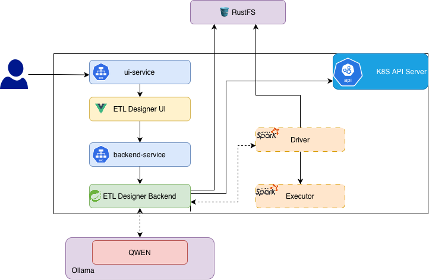
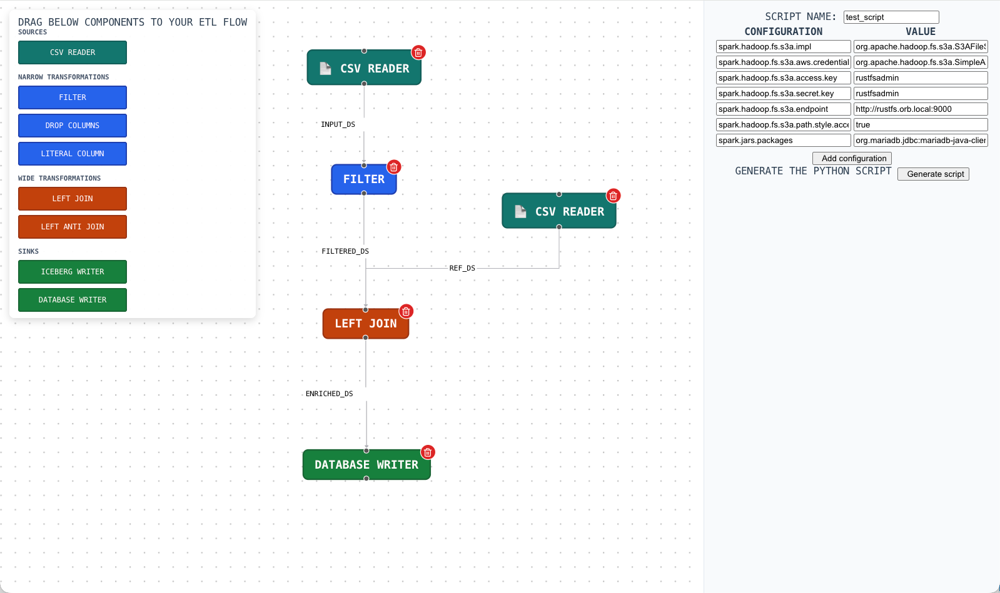

# etl-designer-ui

etl-designer-ui project let you design etl workflows and generate pySpark code. This project intend to streamline pySpark code generation laveraging AI. This project depends on [etl-desginer](https://github.com/niroshan009/etl-designer).

Below is the architeture diagram.



ETL-Designer in action


# Runnning 


# Deploying to local k8s (Orbstack)
To deploy locally, following components are required. K8s Deployment files are configured to run on `Orbstack` with `qwen2.5-coder:7b`
1. `docker-compose.yaml` will start the rustfs and create necessery buckets
2. Local Kubernetes environment (Orb Stack k8s or Minikube)
    - To run spark jobs
    - To deploy etl-desginer-ui + etl-designer
3. Ollama installed with atlease one model running. Out of the box it supports `qwen2.5-coder:7b`
4. Namespace called `spark`
5. Service account called `spark-sa` with enough permissions to submit spark jobs

## Deploy backend
Deploy backend first
```sh
kubectl deploy -f deployment-backend.yaml
```
Deploy frontend
```sh
kubectl deploy -f deployment-ui.yaml
```

# Development setup

Clone the ui project and run below commands
Install dependencies
```sh
npm install
```
Run the ui
```sh
npm run dev
```


