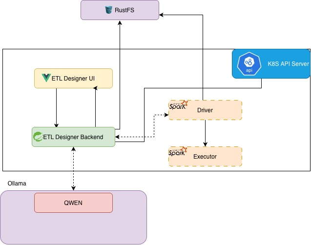

# etl-designer-ui

etl-designer-ui project let you design etl workflows and generate pySpark code. This project intend to streamline pySpark code generation laveraging AI. This project depends on [etl-desginer](https://github.com/niroshan009/etl-designer).

Below is the component diagram.




# Running locally
To run locally developers need below components
1. etl-backend service running
    - run `docker compose up` in etl-backend project as well
        - this `docker-compose.yaml` will start the rustfs and create necessery buckets
2. Local Kubernetes environment (Orb Stack k8s or Minikube)
    - To run spark jobs
    - To deploy etl-desginer-ui + etl-designer
3. Ollama installed with atlease one model running

# Development setup

## Compile and Hot-Reload for Development

```sh
npm install
```
Then run below command.
```sh
npm run dev
```

## Running the application
Directly run etl-designer-ui as container
```sh
docker run -it -p 5173:80 --rm --name etl-designer-ui local/etl-designer-ui:latest
```